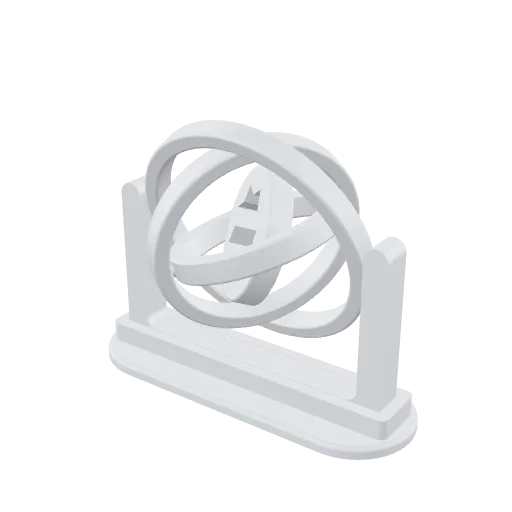
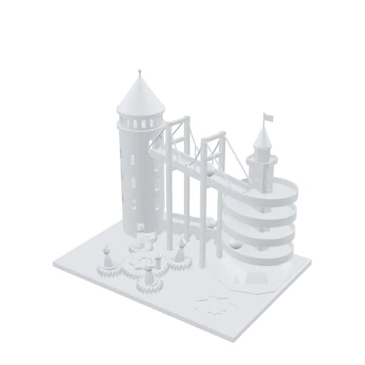
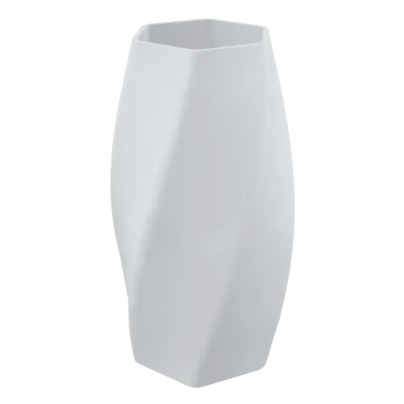
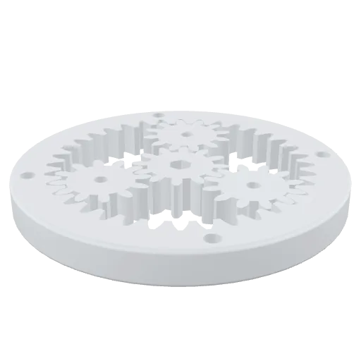
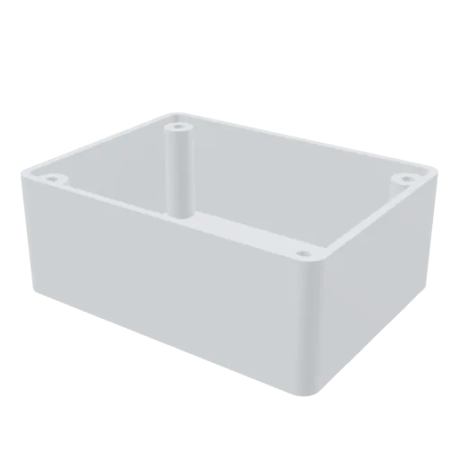

<!-- Generated by tools/gallery.py. Do not edit: change meta.json or the generator. -->
# ArgilCAD Gallery

Parametric 3D models made in [ArgilCAD](https://argildesign.com/products/argilcad/) — every one is a [build123d](https://github.com/gumyr/build123d) Python script you can open, change and print.

**6 models.** Each folder holds the script (`model.py`, the source of truth), its description (`meta.json`), a 3D preview (`model.glb`), four fixed views, a thumbnail and a turntable. [`index.jsonl`](index.jsonl) lists them all, one line each.

<table>
<tr><td align="center" valign="top"> <b><a href="models/gyroscope-fidget/">Gyroscope Fidget</a></b> CC BY-NC-SA 4.0</td><td align="center" valign="top"> <b><a href="models/folding-laptop-stand/">Folding Laptop Stand</a></b> CC BY-NC-SA 4.0</td><td align="center" valign="top"> <b><a href="models/istanbul-marble-machine/">Istanbul Marble Machine</a></b> CC BY-NC-SA 4.0</td></tr>
<tr><td align="center" valign="top"> <b><a href="models/twisted-vase/">Twisted Vase</a></b> CC BY-NC-SA 4.0</td><td align="center" valign="top"> <b><a href="models/planetary-gearbox/">Planetary Gearbox</a></b> CC BY-NC-SA 4.0</td><td align="center" valign="top"> <b><a href="models/electronics-enclosure/">Electronics Enclosure</a></b> CC BY-NC-SA 4.0</td></tr>
</table>

## Use a model

1. Open [ArgilCAD](https://argildesign.com/argilcad/) in a browser (or the desktop app).
2. Paste the model's `model.py` into the code editor and run it.
3. Change any number, or ask the AI for a change. Print it, export it.

Outside the app every model is a plain build123d script: `pip install -r tools/requirements.txt`, then `python tools/runtime.py models/<slug>/model.py` builds it and prints what it measured.

## Licences

Every model carries its own licence in `meta.json` — by default [CC BY-NC-SA 4.0](https://creativecommons.org/licenses/by-nc-sa/4.0/): share and remix with credit, not commercially, and remixes under the same terms. See [LICENSE.md](LICENSE.md). **AI training on this gallery is welcome**; the licence still applies to copies of the models themselves. The tooling is MIT.

## Adding a model

Models come in through ArgilCAD itself ("Share to gallery", coming soon) and are reviewed before they appear here; pull requests from outside are closed. See [CONTRIBUTING.md](CONTRIBUTING.md).

---

## Türkçe

[ArgilCAD](https://argildesign.com/products/argilcad/) ile yapılmış parametrik 3B modeller. Her biri açıp değiştirebileceğin ve basabileceğin bir build123d Python betiği. Bir modelin `model.py` dosyasını [ArgilCAD](https://argildesign.com/argilcad/) kod düzenleyicisine yapıştırıp çalıştırman yeterli. Lisanslar model başına `meta.json` içinde; varsayılan CC BY-NC-SA 4.0 (atıfla paylaş ve değiştir, ticari kullanım yok). Yapay zekâ eğitimine açıktır.
