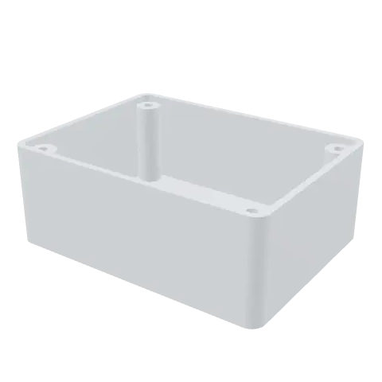
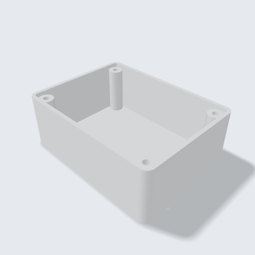
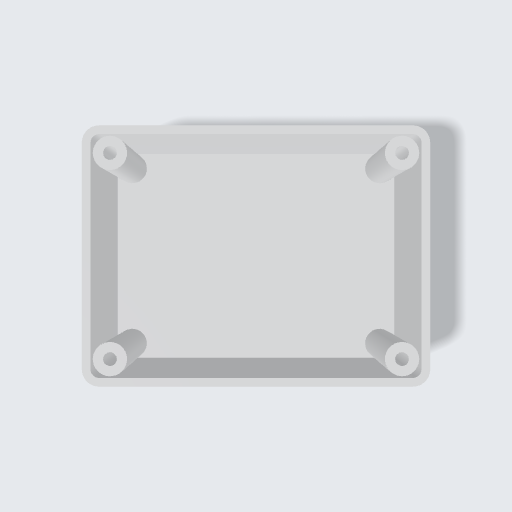

<!-- Generated by tools/gallery.py from meta.json. Do not edit. -->
# Electronics Enclosure

An 80 × 60 × 30 mm project box with 2 mm walls, rounded corners and four M3 screw bosses.

> **Elektronik Kutusu** — 80 × 60 × 30 mm proje kutusu: 2 mm duvar, yuvarlatılmış köşeler ve dört M3 vida yuvası.

| iso | front | top | right |
|---|---|---|---|
|  |  |  |  |

| | |
|---|---|
| Size | 80 × 60 × 30 mm |
| Volume | 28.9 cm³ |
| Parts | 1 |
| Made with | ArgilCAD's AI |
| Author | Argil Design |
| License | [CC BY-NC-SA 4.0](https://creativecommons.org/licenses/by-nc-sa/4.0/) |
| Engine | build123d 0.11.1, OCCT 7.9.3.1.1 |
| Added | 2026-09-08 |
| ID | `g_08dddf0e` |

## Use it

- **Code:** [`model.py`](model.py) — paste it into the code editor of [ArgilCAD](https://argildesign.com/argilcad/) and run it, then change anything.
- **3D:** [`model.glb`](model.glb)
- **Outside the app:** `python tools/runtime.py models/electronics-enclosure/model.py` from the gallery's root builds it with plain build123d.

## Parameters

| Name | Default | Range | Unit |
|---|---|---|---|
| `corner` | 4 | 0 – 12 | mm |
| `wall` | 2 | 1.2 – 4 | mm |

---
© 2026 Argil Design · [CC BY-NC-SA 4.0](https://creativecommons.org/licenses/by-nc-sa/4.0/) · AI training on this gallery is welcome; the licence still applies to copies of the model.
