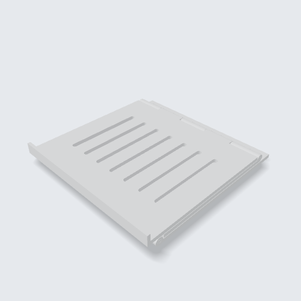
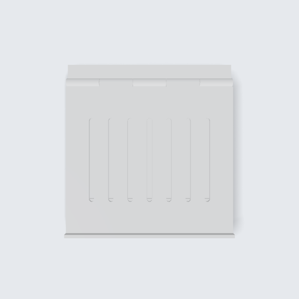

<!-- Generated by tools/gallery.py from meta.json. Do not edit. -->
# Folding Laptop Stand

Base, arm and tray joined by two pinned hinges, modelled folded flat. Every dimension is a variable — fit it to any laptop.

> **Katlanır Laptop Standı** — Taban, kol ve tepsi iki pimli menteşeyle bağlı, düz katlanmış halde modellenmiş. Her ölçü bir değişken; her laptopa uyarlanabilir.

| iso | front | top | right |
|---|---|---|---|
|  |  |  |  |

| | |
|---|---|
| Size | 260 × 270 × 32 mm |
| Volume | 933.6 cm³ |
| Parts | 5 |
| Made with | an AI assistant over MCP (Claude Desktop) |
| Author | Argil Design |
| License | [CC BY-NC-SA 4.0](https://creativecommons.org/licenses/by-nc-sa/4.0/) |
| Engine | build123d 0.11.1, OCCT 7.9.3.1.1 |
| Added | 2026-10-08 |
| ID | `g_1ff169c7` |

## Use it

- **Code:** [`model.py`](model.py) — paste it into the code editor of [ArgilCAD](https://argildesign.com/argilcad/) and run it, then change anything.
- **3D:** [`model.glb`](model.glb)
- **Outside the app:** `python tools/runtime.py models/folding-laptop-stand/model.py` from the gallery's root builds it with plain build123d.

## Parameters

| Name | Default | Range | Unit |
|---|---|---|---|
| `width` | 260.0 | 180 – 400 | mm |
| `plate_t` | 6.0 | 3 – 12 | mm |
| `arm_len` | 220.0 | 120 – 300 | mm |
| `pin_r` | 3.0 | 1.5 – 5 | mm |

---
© 2026 Argil Design · [CC BY-NC-SA 4.0](https://creativecommons.org/licenses/by-nc-sa/4.0/) · AI training on this gallery is welcome; the licence still applies to copies of the model.
