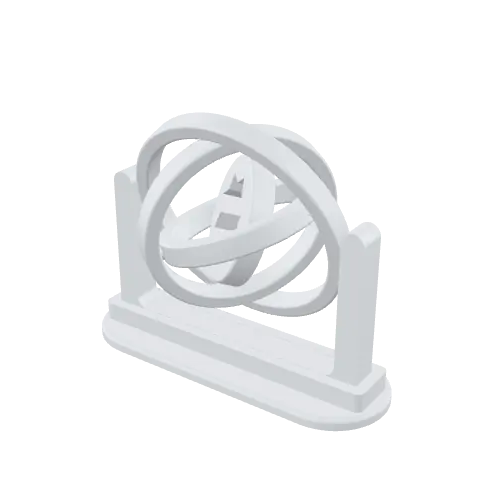
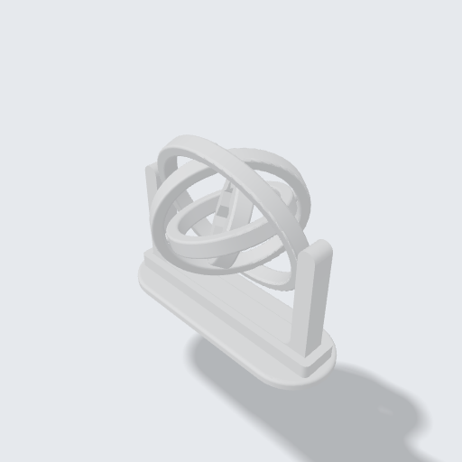
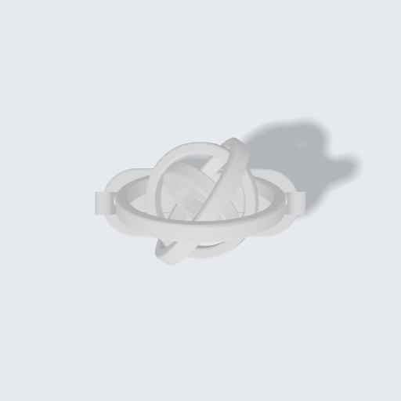
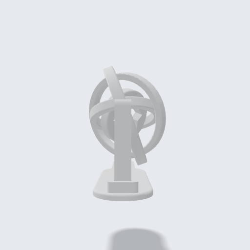

<!-- Generated by tools/gallery.py from meta.json. Do not edit. -->
# Gyroscope Fidget

Three nested rings and a Seljuk-star centre on cone pins, printed in place as one piece; the stand prints separately. Set print_layout = True for the plate layout.

> **Jiroskop Fidget** — İç içe üç halka ve Selçuklu yıldızlı merkez konik pimlerle bağlı; tek parça print-in-place basılır, taban ayrı basılır. Tabla yerleşimi için print_layout = True.

| iso | front | top | right |
|---|---|---|---|
|  |  |  |  |

| | |
|---|---|
| Size | 86 × 45.4 × 68.6 mm |
| Volume | 29.7 cm³ |
| Parts | 6 |
| Printed | yes, 22.96 g, print-in-place |
| Made with | an AI assistant over MCP (Claude Code) |
| Author | Argil Design |
| License | [CC BY-NC-SA 4.0](https://creativecommons.org/licenses/by-nc-sa/4.0/) |
| Engine | build123d 0.11.1, OCCT 7.9.3.1.1 |
| Added | 2026-10-09 |
| ID | `g_b1a570a3` |

## Use it

- **Code:** [`model.py`](model.py) — paste it into the code editor of [ArgilCAD](https://argildesign.com/argilcad/) and run it, then change anything.
- **3D:** [`model.glb`](model.glb)
- **Outside the app:** `python tools/runtime.py models/gyroscope-fidget/model.py` from the gallery's root builds it with plain build123d.

**Printing:** Rings print flat in one piece with the frame; no supports. The stand prints separately.

## Parameters

| Name | Default | Range | Unit |
|---|---|---|---|
| `print_layout` | False |  |  |
| `R1` | 30.0 | 20 – 60 | mm |
| `clearance` | 0.35 | 0.2 – 0.6 | mm |

---
© 2026 Argil Design · [CC BY-NC-SA 4.0](https://creativecommons.org/licenses/by-nc-sa/4.0/) · AI training on this gallery is welcome; the licence still applies to copies of the model.
