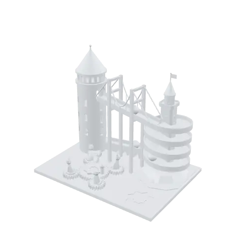
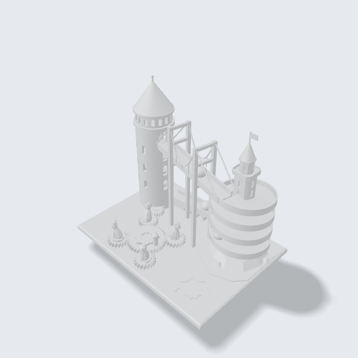
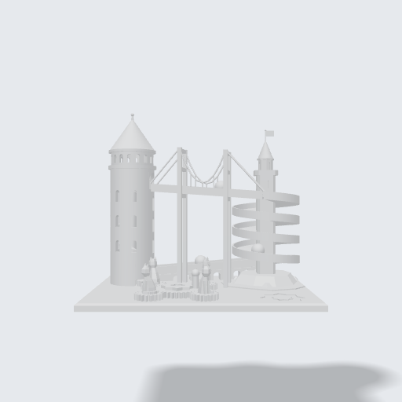
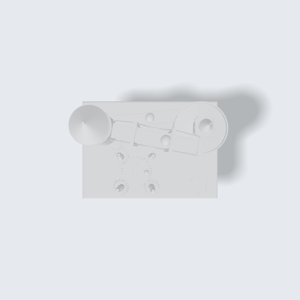
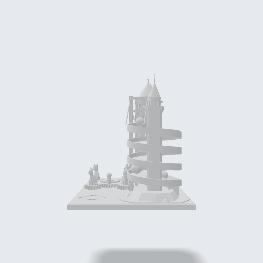

<!-- Generated by tools/gallery.py from meta.json. Do not edit. -->
# Istanbul Marble Machine

A kinetic desk piece: turn the crank and a screw lift carries a marble up the Galata Tower, over the Bosphorus Bridge, round the Maiden's Tower and home along the aqueduct, while four cats spin on their gears.

> **İstanbul Bilye Makinesi** — Kinetik masa objesi: kolu çevir, vidalı asansör bilyeyi Galata Kulesi'nden yukarı taşır; bilye Boğaz Köprüsü'nden geçip Kız Kulesi'nin etrafında döner ve su kemerinden geri gelir. Dört kedi dişlilerinin üstünde döner.

| iso | front | top | right |
|---|---|---|---|
|  |  |  |  |

| | |
|---|---|
| Size | 250 × 180 × 217.9 mm |
| Volume | 793.6 cm³ |
| Parts | 17 |
| Made with | the user's own AI |
| Author | Argil Design |
| License | [CC BY-NC-SA 4.0](https://creativecommons.org/licenses/by-nc-sa/4.0/) |
| Engine | build123d 0.11.1, OCCT 7.9.3.1.1 |
| Added | 2026-10-01 |
| ID | `g_05ae8336` |

## Use it

- **Code:** [`model.py`](model.py) — paste it into the code editor of [ArgilCAD](https://argildesign.com/argilcad/) and run it, then change anything.
- **3D:** [`model.glb`](model.glb)
- **Outside the app:** `python tools/runtime.py models/istanbul-marble-machine/model.py` from the gallery's root builds it with plain build123d.

---
© 2026 Argil Design · [CC BY-NC-SA 4.0](https://creativecommons.org/licenses/by-nc-sa/4.0/) · AI training on this gallery is welcome; the licence still applies to copies of the model.
