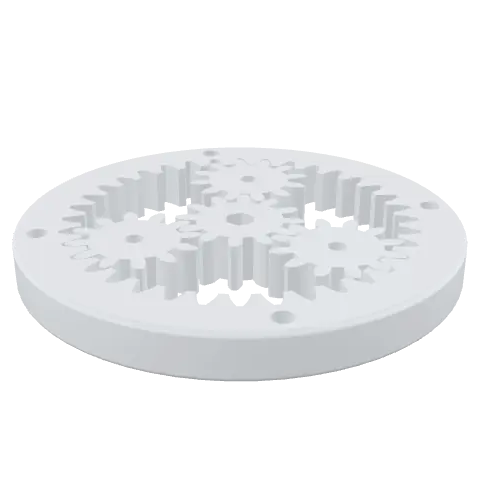
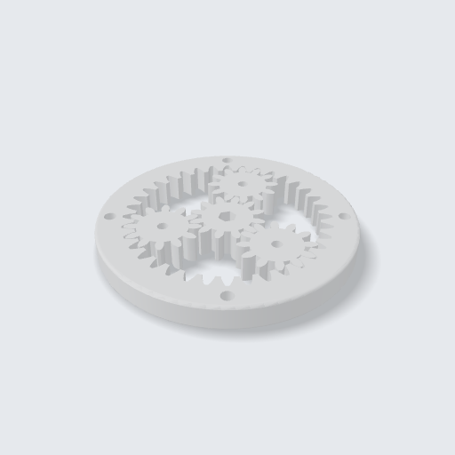
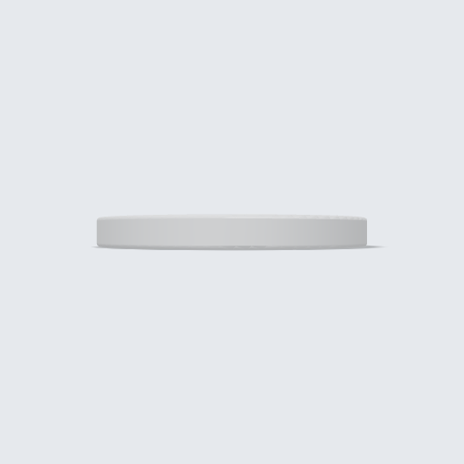
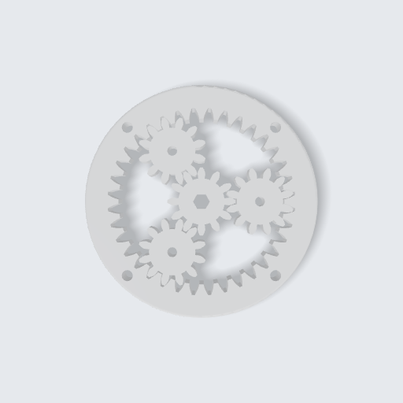
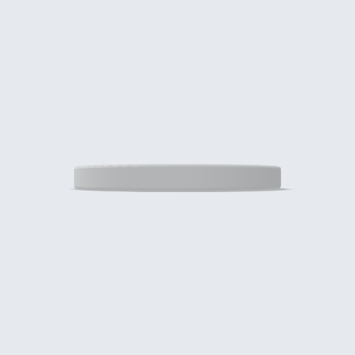

<!-- Generated by tools/gallery.py from meta.json. Do not edit. -->
# Planetary Gearbox

Sun, planets and ring with real involute teeth that mesh without interference — change the module, tooth counts or number of planets.

> **Planet Dişli Kutusu** — Gerçek evolvent dişli güneş, planet ve çember dişliler; girişim olmadan kavrar. Modülü, diş sayılarını ve planet sayısını değiştirebilirsin.

| iso | front | top | right |
|---|---|---|---|
|  |  |  |  |

| | |
|---|---|
| Size | 96 × 96 × 10 mm |
| Volume | 46.7 cm³ |
| Parts | 5 |
| Made with | hand-written code |
| Author | Argil Design |
| License | [CC BY-NC-SA 4.0](https://creativecommons.org/licenses/by-nc-sa/4.0/) |
| Engine | build123d 0.11.1, OCCT 7.9.3.1.1 |
| Added | 2026-09-08 |
| ID | `g_4f2e5e0d` |

## Use it

- **Code:** [`model.py`](model.py) — paste it into the code editor of [ArgilCAD](https://argildesign.com/argilcad/) and run it, then change anything.
- **3D:** [`model.glb`](model.glb)
- **Outside the app:** `python tools/runtime.py models/planetary-gearbox/model.py` from the gallery's root builds it with plain build123d.

## Parameters

| Name | Default | Range | Unit |
|---|---|---|---|
| `M` | 2.0 | 0.5 – 4 | mm |
| `W` | 10.0 | 3 – 30 | mm |
| `N` | 3 | 2 – 6 |  |

---
© 2026 Argil Design · [CC BY-NC-SA 4.0](https://creativecommons.org/licenses/by-nc-sa/4.0/) · AI training on this gallery is welcome; the licence still applies to copies of the model.
