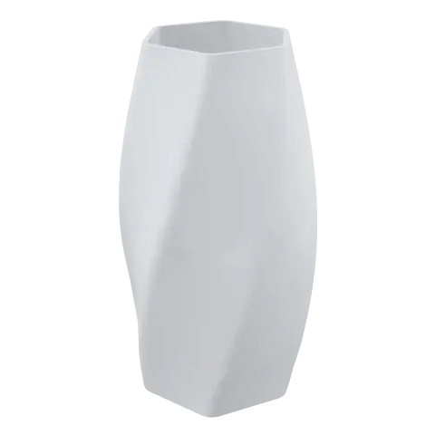
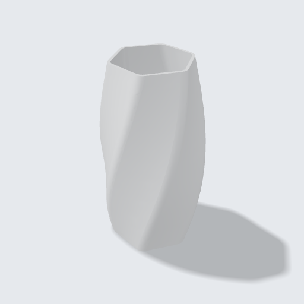
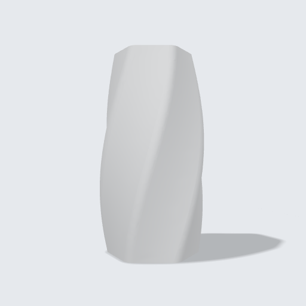
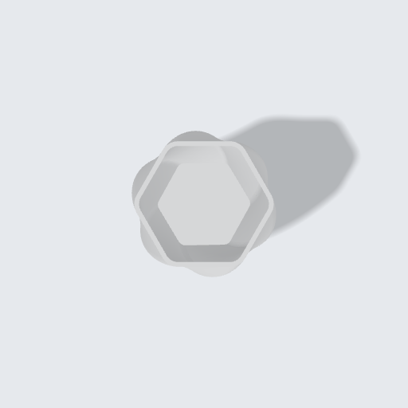
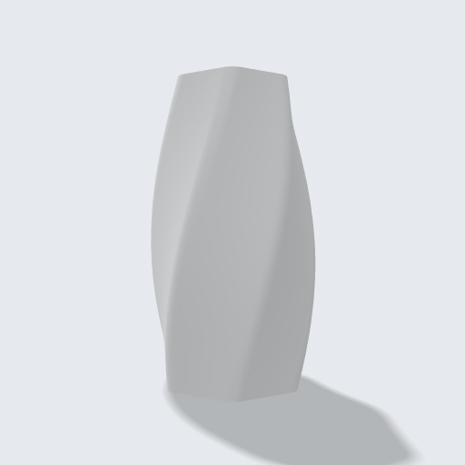

<!-- Generated by tools/gallery.py from meta.json. Do not edit. -->
# Twisted Vase

A hexagonal vase twisted from bottom to top — a vase-mode favourite. Change the sides, the twist or the height.

> **Burgulu Vazo** — Alttan üste burulmuş altıgen vazo; vazo modunda basılmaya çok uygun. Kenar sayısını, burulmayı ya da yüksekliği değiştir.

| iso | front | top | right |
|---|---|---|---|
|  |  |  |  |

| | |
|---|---|
| Size | 62.7 × 66 × 120 mm |
| Volume | 38.1 cm³ |
| Parts | 1 |
| Made with | hand-written code |
| Author | Argil Design |
| License | [CC BY-NC-SA 4.0](https://creativecommons.org/licenses/by-nc-sa/4.0/) |
| Engine | build123d 0.11.1, OCCT 7.9.3.1.1 |
| Added | 2026-09-15 |
| ID | `g_4e5ef637` |

## Use it

- **Code:** [`model.py`](model.py) — paste it into the code editor of [ArgilCAD](https://argildesign.com/argilcad/) and run it, then change anything.
- **3D:** [`model.glb`](model.glb)
- **Outside the app:** `python tools/runtime.py models/twisted-vase/model.py` from the gallery's root builds it with plain build123d.

## Parameters

| Name | Default | Range | Unit |
|---|---|---|---|
| `height` | 120.0 | 40 – 250 | mm |
| `radius` | 34.0 | 15 – 80 | mm |
| `sides` | 6 | 3 – 12 |  |
| `twist` | 60 | 0 – 180 | ° |
| `wall` | 1.6 | 0.8 – 4 | mm |

---
© 2026 Argil Design · [CC BY-NC-SA 4.0](https://creativecommons.org/licenses/by-nc-sa/4.0/) · AI training on this gallery is welcome; the licence still applies to copies of the model.
